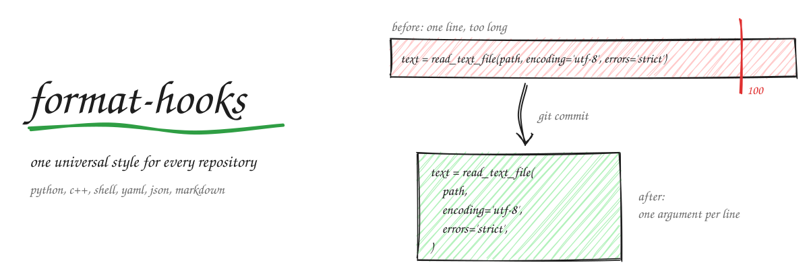
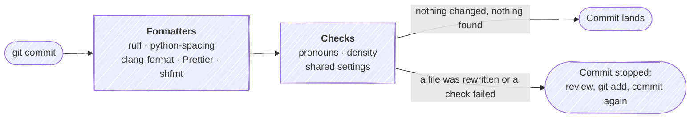

<p align="center">
  <picture>
    <source media="(prefers-color-scheme: dark)" srcset="docs/assets/banner-dark.svg">
    
  </picture>
</p>

<p align="center">
  <a href="https://pre-commit.com"></a>
  <a href="https://docs.astral.sh/ruff/"></a>
  
  <a href="LICENSE"></a>
</p>

<p align="center">
  <a href="#quick-start"><b>Quick start</b></a>
  &nbsp;/&nbsp;
  <a href="#the-hooks"><b>The hooks</b></a>
  &nbsp;/&nbsp;
  <a href="#shared-settings"><b>Shared settings</b></a>
  &nbsp;/&nbsp;
  <a href="#turning-a-check-off"><b>Turning a check off</b></a>
</p>

<br>

Welcome to **format-hooks**! This package provides any repository our formatting style at commit time.
One `rev:` line pins ruff, clang-format, Prettier and shfmt together with shared settings.
Four checks of its own cover what those tools do not include: blank-line placement in Python,
personal pronouns in comments, comment density, and settings that differ from the shared copy.

## What one commit does

Below is an example of a real run of the hooks on a small Python file.
The formatters rewrite unformatted files; the hook checks report what needs attention.

```diff
 from settings_io import parse_settings, read_text_file


 def load_settings(path):
     # here we read the file and check every key
-    text = read_text_file(path, encoding_name='utf-8', errors_policy='strict', newline_mode='universal')
+    text = read_text_file(
+        path,
+        encoding_name='utf-8',
+        errors_policy='strict',
+        newline_mode='universal',
+    )
     settings = parse_settings(text, allow_unknown_keys=False)
     if not settings:
         raise ValueError(path)
+
     return settings
```

```console
$ git commit
ruff check...............................................................Failed
E501 Line too long (104 > 100)
ruff format (one argument per line)......................................Failed
- files were modified by this hook
python spacing...........................................................Failed
- files were modified by this hook
no personal pronouns in comments.........................................Failed
settings.py:5: personal pronoun "we" in comment
comment density..........................................................Passed
shared formatter settings unchanged......................................Passed
```

Once you fix any failures, stage the corresponding files, and commit again, every hook should pass.

## Quick start

Add this to `.pre-commit-config.yaml` at the repository root:

```yaml
repos:
  - repo: https://github.com/fishnos/format-hooks
    rev: v0.1.0
    hooks:
      - id: ruff-check
      - id: ruff-format
      - id: python-spacing
      - id: comment-pronouns
      - id: comment-density
      - id: clang-format
      - id: prettier
      - id: shfmt
      - id: config-drift
```

Then install the hook and write the shared settings files:

```sh
pre-commit install
pip install 'git+https://github.com/fishnos/format-hooks@v0.1.0'
format-hooks sync-config
pre-commit run --all-files
```

> [!TIP]
> Leave out the hooks for languages the repository does not use. A hook with
> no matching files is skipped anyway, and so the full list is also safe.

## How a commit flows



## The hooks

| Hook               | What it does                                                                                                              | Files                                     | Edits files |
| :----------------- | :------------------------------------------------------------------------------------------------------------------------ | :---------------------------------------- | :---------: |
| `ruff-check`       | Lints Python and applies ruff's safe fixes.                                                                               | Python                                    |     yes     |
| `ruff-format`      | Formats Python. A call too long for one line gets one argument per line, in one pass.                                     | Python                                    |     yes     |
| `python-spacing`   | Puts blank lines before `return`, around blocks and after docstrings; keeps an assignment next to the block that uses it. | Python                                    |     yes     |
| `comment-pronouns` | Rejects "I", "we", "you" and the like in comments and Python docstrings.                                                  | Python, C, C++, shell, YAML, TOML, JS, TS |     no      |
| `comment-density`  | Blocks a file of 20 or more lines when more than 20% of them are comments. The header comment does not count.             | Python, C, C++, shell, YAML, TOML, JS, TS |     no      |
| `clang-format`     | Formats C and C++.                                                                                                        | C, C++                                    |     yes     |
| `prettier`         | Formats web and config files.                                                                                             | YAML, JSON, Markdown, JS, TS              |     yes     |
| `shfmt`            | Formats shell scripts.                                                                                                    | shell                                     |     yes     |
| `config-drift`     | Fails when the repository's shared settings files differ from the ones shipped here.                                      | settings files                            |     no      |

The tool versions are pinned in this repository. As such, moving `rev:` moves them
all at once and every repository on the same `rev:` formats identically.

## Shared settings

The settings live in four files at the repository root:

| File               | Read by        | Shared contents                                            |
| :----------------- | :------------- | :--------------------------------------------------------- |
| `ruff.toml`        | ruff           | 100 columns, Python 3.12, single quotes, the lint rule set |
| `.clang-format`    | clang-format   | Google style, 100 columns                                  |
| `.prettierrc.json` | Prettier       | 100 columns, single quotes, prose left unwrapped           |
| `.editorconfig`    | shfmt, editors | Two-space indents for shell scripts                        |

`format-hooks sync-config` writes all four. It replaces the last three
outright. In `ruff.toml`, it solely rewrites the shared keys (`line-length`,
`target-version`, `lint.select`, `format.quote-style`), so a repository retains
its own `ignore` and `extend-exclude` lists.

> [!NOTE]
> Ruff settings kept in `pyproject.toml` or `.ruff.toml` are reported rather
> than overwritten. Move them into `ruff.toml`, then run `sync-config` again.

## Turning a check off

The pronoun and density checks each have two off switches.

**For one file**, place the marker in a comment anywhere in that file:

```python
# format-hooks: allow-comments
# format-hooks: allow-pronouns
```

**For one commit**, skip the hook by its id:

```sh
SKIP=comment-density git commit
SKIP=comment-pronouns git commit
```

**For a whole repository**, the density limits can be loosened in
`.pre-commit-config.yaml`:

```yaml
- id: comment-density
  args: [--max-share=0.3, --min-lines=40]
```

## Running a check by hand

```sh
format-hooks python-spacing --check       # report only, write nothing
format-hooks comment-pronouns path/to/file.py
format-hooks config-drift
```

Without paths, a hook check looks at every file in the repository (untracked files
included) and skips anything gitignored.

<details>
<summary><b>Development</b></summary>

<br>

```sh
python3 -m venv .venv
.venv/bin/pip install -e '.[test]'
.venv/bin/pytest -q
```

The tests require only the Python standard library, pytest and ruff.

</details>

<br>

<p align="center"><sub>MIT licensed. See <a href="LICENSE">LICENSE</a>.</sub></p>
